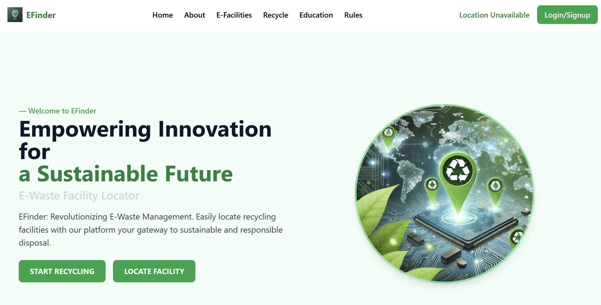
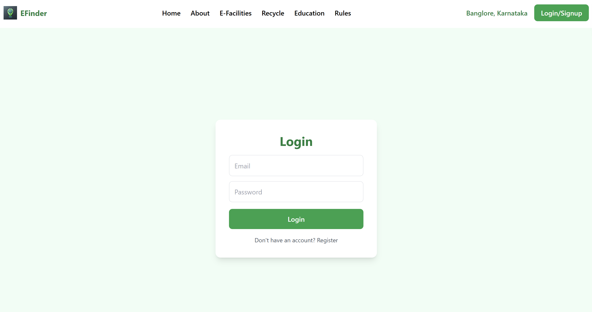
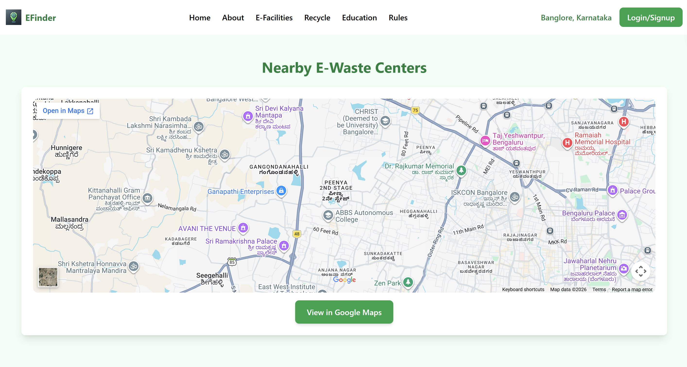
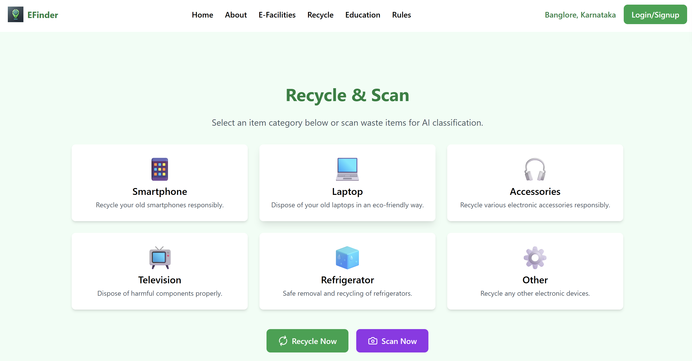
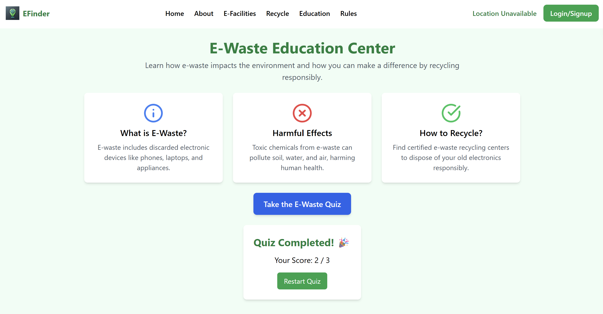
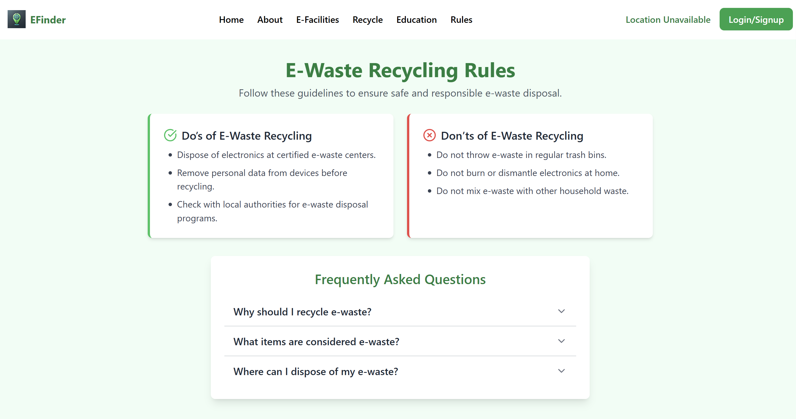
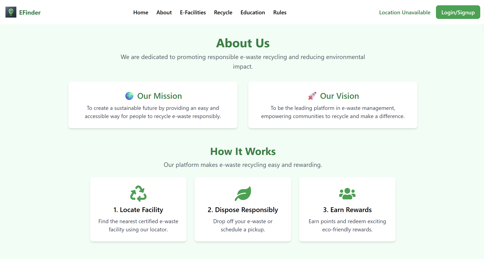

# ♻️ E-Waste Facility Locator

An end-to-end full-stack web application designed to help users locate nearby e-waste recycling centers, learn proper disposal guidelines, evaluate e-waste knowledge via an interactive quiz, and utilize an AI-driven waste classification workflow.

---

## ⚡ Quick Start (3 steps)

### Step 1 — Clone the Repository

```bash
git clone https://github.com/YakeshKrishnanD/E-Waste-Facility-Locator.git
cd E-Waste-Facility-Locator

```

### Step 2 — Configure Environment Variables

* Set up your backend `.env` file under the `backend/` directory with required database/API keys.
* Set up your frontend `.env` file under the `frontend/` directory to point to your backend server endpoint.

### Step 3 — Install & Run

* **Backend:**
```bash
cd backend
npm install
npm start

```


* **Frontend:**
```bash
cd frontend
npm install
npm start

```


Open **http://localhost:3000** in your browser.

---

## 📋 Features

| Feature | Description |
| --- | --- |
| **Facility Locator** | Interactive map/list interface to discover verified e-waste collection and recycling facilities |
| **Waste Classifier** | Intelligent classification tool to help identify and categorize electronic waste items |
| **Educational Quiz** | Interactive gamified quiz module to test and improve e-waste recycling awareness |
| **Recycling Guide & FAQ** | Comprehensive rules, procedures, and frequently asked questions regarding sustainable e-waste disposal |
| **User Authentication** | Secure login and registration system for personalized user dashboards |

---

## 🗂️ Project Structure

```text
E-Waste-Facility-Locator/
├── backend/                      ← Server-side application (Node.js/Express)
│   ├── config/                   ← Configuration files & database connections
│   ├── controllers/              ← Route logic and request handlers
│   ├── data/                     ← Static or initial seed data
│   ├── middleware/               ← Authentication & error handling middleware
│   ├── models/                   ← Database schemas
│   ├── routes/                   ← API endpoint routing definitions
│   ├── .env                      ← Backend environment variables
│   ├── app.py / server.js        ← Application entry points
│   └── package.json              ← Backend dependencies
├── frontend/                     ← Client-side application (React / Tailwind)
│   ├── public/                   ← Static public assets
│   ├── src/                      ← React components, pages, and styling
│   │   └── pages/                ← Application views (Auth, Dashboard, Classifier, etc.)
│   ├── .env                      ← Frontend environment variables
│   ├── tailwind.config.js        ← Tailwind CSS styling configuration
│   └── package.json              ← Frontend dependencies
├── screenshot/                   ← Project visual assets & UI snapshots
│   ├── Landingpage.png
│   ├── Loginpage.png
│   ├── facilitylocator.png
│   ├── recyclepage.png
│   ├── Quiz.png
│   ├── rules&FAQ.png
│   └── aboutpage.png
├── .gitignore                    ← Ignored build artifacts & secrets
└── LICENSE                       ← Project license

```

---

## 🖥️ Screenshots & Visual Interface

### 🌐 1. Application Landing Page



### 🔐 2. User Authentication & Login Page



### 📍 3. Facility Locator Map Interface



### ♻️ 4. E-Waste Recycling Center Page



### 🧠 5. Interactive E-Waste Quiz Module



### ❓ 6. Rules & FAQ Guide



### ℹ️ 7. About Page



---

## 👨‍💻 Author

**Yakesh Krishnan D**

E-Waste Facility Locator — Sustainable electronic waste management and community recycling platform.

⭐ If you find this project useful, consider giving the repository a star.
